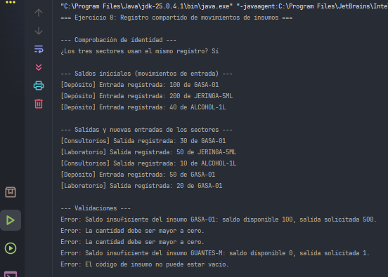
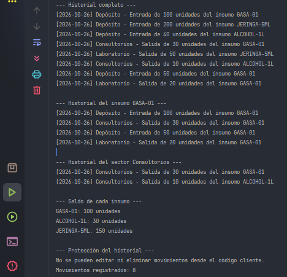

# Ejercicio 08 - Registro Compartido de Movimientos de Insumos

## Descripción

Los sectores de depósito, consultorios y laboratorio de un hospital registraban por separado los movimientos de insumos. La administración necesita un historial unificado para identificar entradas, salidas y sectores responsables. Este ejercicio centraliza todos los movimientos en un único registro compartido.

## Objetivos

- Centralizar información mediante Singleton y proteger la integridad de un registro compartido.
- Registrar movimientos con código de insumo, tipo (entrada o salida), cantidad, sector y fecha.
- Consultar el historial completo o filtrarlo por insumo y por sector.
- Calcular el saldo de cada insumo a partir de sus movimientos.
- Validar que las cantidades sean positivas y que las salidas no superen el saldo disponible.

## Implementación del patrón Singleton

Se utiliza la variante **enum Singleton**:

- `SupplyMovementLog` es un `enum` con un único valor, `INSTANCE`.
- La JVM garantiza que existe una sola instancia, creada de forma segura.
- Los tres sectores acceden mediante `SupplyMovementLog.INSTANCE`.

## Propósito de la clase

- `SupplyMovementLog`: es el Singleton. Guarda los movimientos en una lista privada, valida cada registro, filtra el historial y calcula saldos.
- `SupplyMovement`: movimiento inmutable (`record`); una vez registrado no puede editarse.
- `MovementType`: enumeración con los tipos de movimiento (entrada y salida).
- `Sector`: enumeración con los sectores del hospital (depósito, consultorios y laboratorio).
- `SectorModule`: representa a un sector; registra entradas y salidas en el registro compartido.
- `Main`: demuestra el registro desde los tres sectores, las validaciones, los filtros y el cálculo de saldos.

## Concepto clave

La **integridad** de un registro compartido depende de que sus datos solo puedan cambiar mediante operaciones controladas. Por eso los movimientos son inmutables, las consultas devuelven copias inmodificables y no existen métodos para editar ni eliminar. El saldo no se almacena: se **calcula** a partir de los movimientos, y el saldo inicial de cada insumo es simplemente un movimiento de entrada.

## Resultado

## Conclusión

Con un único registro, la administración puede ver qué sector movió cada insumo y cuánto stock queda de cada uno. Las validaciones evitan saldos negativos y la inmutabilidad de los movimientos garantiza que el historial sea confiable.
